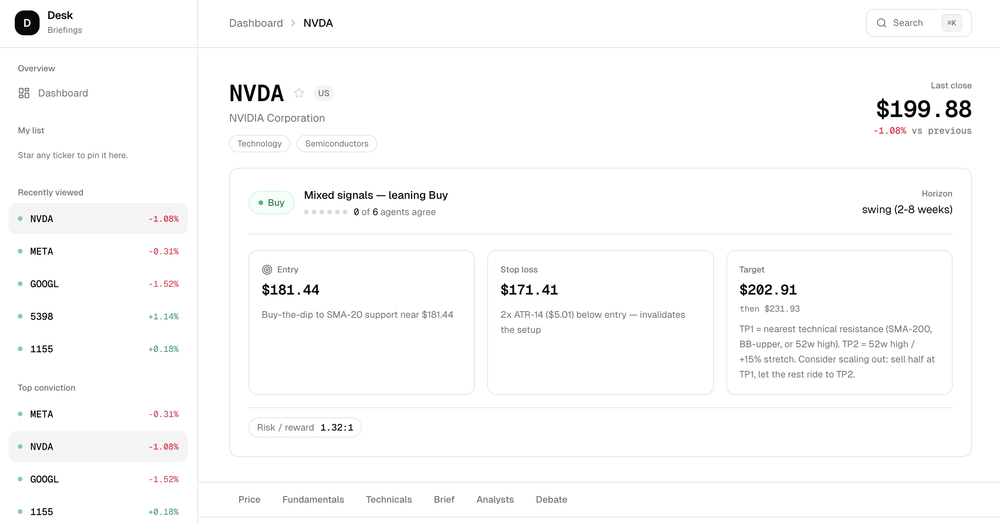

# AI Stock Analysis

Four analysts research a stock. A bull and a bear challenge the evidence. A research manager rules on the argument, and a synthesizer produces a briefing with conditional price levels.

The same workspace also provides a price-only momentum dashboard and portfolio strategy comparisons. You can inspect the data, disagreement, and research assumptions behind each output.



*Example ticker briefing. Prices and signals shown are historical research output.*

[Quick start](#quick-start) · [AI research](#ai-research) · [Momentum](#price-only-momentum) · [Backtesting](#backtesting-and-portfolio-research) · [Deployment](#api-and-deployment)

## What you can do

| Workflow | Output | Requires an LLM key? |
| --- | --- | --- |
| Fetch market data | Price history, financials, news, and computed technical indicators | No |
| Research a ticker | Analyst reports, bull/bear debate, research verdict, and briefing | Yes |
| Follow momentum | Daily rankings, monthly model weights, and matched market references | No |
| Compare strategies | Historical allocation results, cost scenarios, and uncertainty estimates | Depends on the research mode |

Ticker research supports **US equities and Bursa Malaysia** through yfinance. The standalone momentum dashboard uses a configured US stock universe.

**The AI pipeline has not demonstrated an after-cost advantage over strict buy-and-hold.** The [September comparison](reports/analysis/backtest-2026-09-24.md) is development research. Briefings and model weights remain research outputs; the repository places no brokerage orders and reads no personal holdings.

## Quick start

Use Python 3.12+. For the dashboard, use Node.js 20, matching CI.

```bash
git clone https://github.com/KelvinYou/ai-stock-analysis.git
cd ai-stock-analysis
python -m venv .venv
source .venv/bin/activate
pip install -e .

# Fetch public market data without calling an LLM.
stock-fetch AAPL MSFT GOOGL
```

Start the dashboard in a second terminal:

```bash
cd web
npm ci
npm run dev
```

Open <http://localhost:3000>. Locally, the screener reads the repository's `data/` directory; fetching prices alone does not create an AI briefing.

| Route | What it shows |
| --- | --- |
| `/` | Screener with prices, signals, conviction, and research freshness |
| `/AAPL` | Ticker detail with price history, fundamentals, analysts, and debate |
| `/momentum` | Independent price-only rankings and monthly model basket |
| `/allocation` | Exported historical strategy comparisons and allocation research |
| `/about` | Pipeline diagram and glossary |

Ticker pages also provide a **Share** button for a 16:9 summary card, including price levels, a sparkline, and a QR code. The card is also used for Open Graph previews.

## AI research

Set your Anthropic credential in the terminal where you run the analysis:

```bash
export ANTHROPIC_API_KEY=your-api-key

# These commands make paid model calls.
stock-analysis AAPL --market US -v
stock-analysis MAYBANK --market MY -v

# Override analyst/debate models and debate depth.
stock-analysis AAPL --rounds 3 --model haiku --debate-model opus -v
```

### How a briefing is built

| Stage | Responsibility | Default model |
| --- | --- | --- |
| Data ingestion | Fetch prices, financials, and news; compute technical indicators | Deterministic |
| Four parallel analysts | Evaluate fundamentals, sentiment, technicals, and macro/FX | Haiku |
| Bull/bear debate | Build competing cases and rebut them across multiple rounds | Opus |
| Research manager | Rule on the argument; identify invalidation conditions and evidence gaps | Sonnet |
| Outcome memory | Supply resolved prior outcomes and calibration context | Deterministic |
| Synthesis and risk checks | Produce the briefing; calculate conviction gates and conditional levels | Sonnet + deterministic checks |

Analyst convergence is computed from the reports. Conviction is capped by the confidence-weighted analyst consensus. Entry, stop, and target levels require sufficient conviction, convergence, and usable technical inputs; a neutral result or unavailable levels is valid.

Outcome memory only exposes calls resolved by the analysis date. Calibration is reported as context and does not silently rescale signals. Model defaults and optional stages live in [`config.py`](src/stock_analysis/config.py).

[`pipeline.json`](pipeline.json) owns the pipeline structure used by the dashboard and generated [architecture documentation](architecture.md).

### Fetching data separately

```bash
stock-fetch AAPL MSFT GOOGL
stock-fetch --universe sp500
stock-fetch --universe nasdaq100
stock-fetch --universe my-klci
```

The Malaysia adapter resolves supported names such as `MAYBANK` to Bursa codes and applies the `.KL` provider suffix.

## Price-only momentum

`/momentum` runs independently of the AI pipeline, database, and model credentials. [`config/momentum.json`](config/momentum.json) defines the strategy ID, universe, lookback, and selection count.

The current rule ranks **nine US stocks by trailing 12-month return** and selects **three equal-weight sleeves**:

- **Daily preview:** rankings from the latest synchronized completed price session.
- **Monthly basket:** rankings anchored to the preceding month-end, with modeled execution at the next common session open. Daily rank changes do not trigger intramonth rotation.
- **Reference context:** matched-date comparisons with SPY, VOO, VT, and the fixed universe held at equal initial weights, where data is available.

The rule still selects three stocks when every return is negative. It has no automatic cash filter or AI veto. Historical baskets and curves are reconstructions from provider-adjusted prices; changing the universe requires fresh validation.

From the repository root, with the Python environment activated:

```bash
# Download public prices and publish the validated JSON/hash pair.
python scripts/refresh_momentum_dashboard.py

# Alternatively, use existing CSVs without downloading prices.
python scripts/refresh_momentum_dashboard.py --prices-dir /path/to/public-prices
```

Local development reads `web/data/momentum.json` and its companion SHA-256 file. Production defaults to the public `main` branch snapshot; `MOMENTUM_SNAPSHOT_URL` can override the HTTPS JSON source, which must have a companion `.sha256` file.

The [refresh workflow](.github/workflows/momentum.yml) is configured for 01:15 UTC daily. Refresh failures preserve the previous published snapshot. Readers verify its hash and structure, and withhold current targets when freshness checks fail. Browser refresh retrieves published snapshots; it does not download new market prices.

See the [standalone momentum design](docs/design/momentum-standalone.md) and [reference context contract](docs/design/momentum-reference-context.md) for source evidence, calendar rules, and failure behavior.

## Backtesting and portfolio research

```bash
# Replay the AI pipeline over historical dates; requires model credentials.
# Costs are one-way basis points, charged on entry and exit.
stock-analysis-backtest --tickers AAPL,MSFT \
  --start 2024-01-01 --end 2024-12-31 --cost-bps 10
```

Research modes include deterministic factor tests, cross-sectional allocation, rescoring frozen predictions, session-based research without an API key, and external validation. The [backtesting reference](docs/backtesting.md) contains commands, point-in-time evidence requirements, and scoring policies.

Reports include Wilson hit-rate intervals, overlap-adjusted effective sample sizes, probabilistic Sharpe, and Deflated Sharpe for strategy comparisons. Zero transaction cost is the default for the example backtest mode; set it explicitly when assessing after-cost results.

Completed cloud analysis runs can also feed `POST /api/v1/portfolio-plans`. It compares nine research weight views spanning passive baselines, momentum allocation, analyst filters, AI signals, and hybrids. The `stock-analysis-portfolio` CLI exports, plans, freezes, verifies, scores, and compares forward cohorts. See [portfolio research](docs/backtesting.md#portfolio-decisions) for prerequisites.

The `/allocation` dashboard reads a hash-verified export selected by [`config/allocation_research.json`](config/allocation_research.json). Rebuild that export with:

```bash
python scripts/export_allocation_research.py
```

Historical allocation experiments and the current momentum configuration may use different universes. An older experiment does not validate a changed strategy. Research outputs retain `promotion_ready=false`; personal sizing, concentration limits, and account decisions belong to the consuming application.

## API and deployment

```bash
# Local API, from the repository root.
uvicorn stock_analysis.api.app:app --reload
```

Storage defaults to local files. Production uses Supabase with a FastAPI control plane and a separate durable worker from the same Docker image:

```bash
stock-analysis-worker
```

The API accepts `X-Idempotency-Key` for safe analysis retries. Keys bind to the full request; reusing a key with changed settings returns `409`. A cloud run becomes the latest visible briefing only after its final briefing artifact exists.

For a deployed dashboard, configure the server-side API connection:

```dotenv
NEXT_PUBLIC_SITE_URL=https://your-host.example
STOCK_ANALYSIS_API_URL=https://api.your-host.example
STOCK_ANALYSIS_API_TOKEN=your-fastapi-bearer-token
```

Keep API tokens, Supabase service credentials, and `ANTHROPIC_API_KEY` server-side. The worker uses the pinned Agent SDK's bundled Claude Code CLI; deployed workers authenticate through the API key.

Follow the [deployment guide](docs/deployment.md) for the full environment matrix, Docker commands, and acceptance checks. The [Supabase guide](docs/supabase.md) covers schema setup, migration, and persistence behavior.

## Repository map

| Path | Owner |
| --- | --- |
| `src/stock_analysis/data/` | Market adapters, technicals, local and cloud storage |
| `src/stock_analysis/agents/`, `debate/`, `synthesis/` | AI research stages |
| `src/stock_analysis/backtest/` | Historical replay, scoring, statistics, and portfolio simulation |
| `src/stock_analysis/momentum_*.py` | Momentum snapshots, calendar, context, and reconstructed paths |
| `src/stock_analysis/api/`, `worker.py` | API and durable job execution |
| `config/` | Public strategy rules and research export selection |
| `data/<TICKER>/` | Local market snapshots and research artifacts |
| `web/` | Next.js / React dashboard; `web/data/` holds public research exports |
| `reports/analysis/` | Dated research results and supporting evidence |
| `contracts/`, `postman/` | Generated API contract and acceptance collection |

Local ticker runs update flat files such as `price_history.csv`, `fundamentals.json`, `analyst_reports.json`, and `briefing.json`. Price history is merged; research artifacts represent the latest run. Outcomes are append-only. Dated subdirectories support historical runs; see [`DataStore`](src/stock_analysis/data/store.py) for the storage contract.

## Development

```bash
pip install -e ".[dev]"
ruff check src tests scripts
pytest -q

# Check generated contracts and architecture.
python scripts/generate_openapi.py --check
python scripts/generate_postman.py --check
python scripts/sync_architecture.py --check

cd web
npm run typecheck
npm run check:pipeline
npm run check:allocation
npm run check:momentum
npm run build
```

After editing `pipeline.json`, run `python scripts/sync_architecture.py` from the repository root to regenerate the architecture diagram.

## License

[MIT](LICENSE). Research and educational use; outputs are not financial advice.
